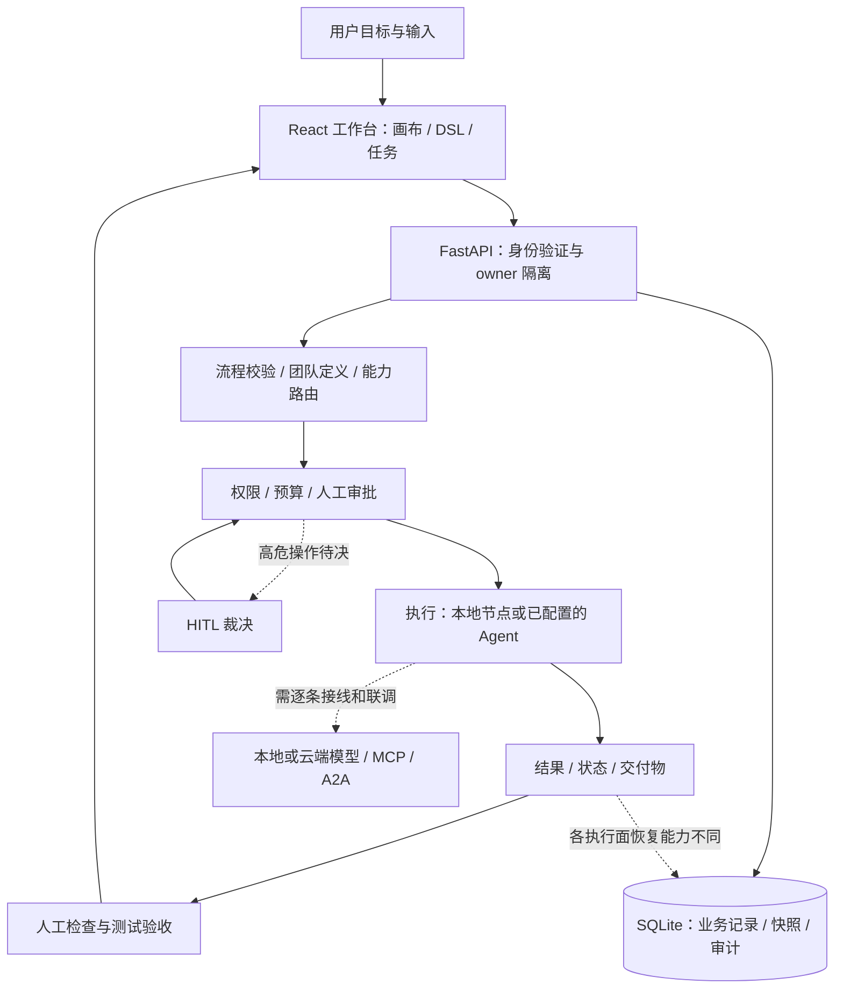

<p align="center">
  
</p>

<h1 align="center">FY Orbit · 星轨 (Find Yourself)</h1>

<p align="center">
  <strong>本地优先的多智能体编排与统一调度中台</strong><br>
  <em>Local-First Multi-Agent Orchestration &amp; Unified Scheduling Workbench</em>
</p>

<p align="center">
  <a href="https://github.com/intp41455/FY-Orbit/releases/download/v1.0.0/FY-Orbit-Windows-v1.0.0.zip">
    
  </a>
  
  
  
  
  
  
  
  
</p>

---

## ⚖️ 授权声明 / License Notice

本项目 **FY Orbit · 星轨** 采用「源码公开、限制商用」（Source-Available）的授权模式，
许可证为 **Business Source License 1.1**（授权变更日 4 年后自动转为 Apache License 2.0）。

- ✅ **允许**：个人学习、研究、评估；非商业用途的二次开发与分发（须保留本声明与许可证）。
- ❌ **禁止**：任何形式的商业使用——包括但不限于商业产品/服务集成、SaaS 托管、对外收费部署、
  企业内部生产环境使用。
- ❌ **禁止**：摘取本项目核心思路、架构或代码，包装为闭源产品据为己有。
- ❌ **禁止**：移除或篡改本授权声明、版权与许可证信息。

如需商业授权，请联系：`intp41455@gmail.com`

**FY Orbit** is source-available and **free for non-commercial use only**, licensed under the
Business Source License 1.1 (converting to Apache License 2.0 four years after each release).

- ✅ **Permitted**: Personal learning, research, evaluation, and non-commercial modification/distribution.
- ❌ **Prohibited**: Any commercial use, including commercial product integration, SaaS offerings,
  paid deployment, or internal production use by for-profit entities.
- ❌ **Prohibited**: Repackaging this project's architecture, core ideas, or code into a closed-source product.
- ❌ **Prohibited**: Removing or altering this license notice or copyright information.

For commercial licensing, contact: `intp41455@gmail.com`

> 完整条款见 [LICENSE](./LICENSE) · Full terms in [LICENSE](./LICENSE)

---

## 使用前先了解

FY Orbit 是本地优先的多智能体工作台，当前适合技术用户评估和受控试用。
画布、团队、知识库、工程工具和个人空间均有实现入口，但覆盖范围与验证成熟度不同。
公开 main、历史 Release 和本地修改是不同版本，下载包不能自动获得 main 后续修复。

非商业使用按 BSL 1.1 条款授权；商用需另行授权。模型 API、外部服务、硬件和维护可能产生费用。
网站主页是产品介绍，在线工作台前端预览不能替代本机后端。

## 架构与一次任务的流程



实线描述现有组件和操作路径；虚线标出需要配置、接线或专项验证的边界。
这张图描述架构，不代表所有节点组合均已通过端到端验收。

## 当前能力与边界

| 能力 | 现有实现 | 使用边界 |
|---|---|---|
| 画布与 DSL | 编译校验、节点属性、受限代码导入导出、单步调试 | 受注册表和参数契约约束，不支持任意 Python 与任意拓扑的无损互转 |
| 统一调度 | Hub 注册、能力路由、顺序/并行调用、任务与团队 | 外部 Agent 必须满足支持的协议，并完成实际连接测试 |
| 模型与工具 | provider、模型网关、工具与连接器实现 | 部分画布 API 缺 resolver 接线；配置模型不等于所有执行面都能调用 |
| HITL | 中断记录、裁决接口、团队暂停/恢复 | 新待决 UI 组件尚需接入页面；SSE 为单进程机制 |
| 持久化 | SQLite 业务记录、流程草稿/发布版本、暂存与快照 | DSL 运行/调试记录仍主要在内存；不保证重启自动恢复全部执行面 |
| 知识库 | 文档导入、词法/向量/混合检索、3D 展示 | 默认哈希特征并非训练型语义模型；星图不构成知识事实证明 |
| 工程工具 | 文件、Git、终端、预览与差异接口 | 文件授权范围和运行环境需要配置；脚本进程限制不是强安全沙箱 |
| 个人空间 | 小屋、角色、画像与命理入口 | 实验能力按页面提示使用；多设备实时同步仍在研发 |

代码与边界可从 [AGENTS.md](AGENTS.md) 和 [本轮审计](deliverables/engineering-assurance/audit-2026-10-11.md) 查看。
截图展示特定版本的界面，不是全部功能通过验收的证明。

## 下载与首次启动

请从 [GitHub Releases](https://github.com/intp41455/FY-Orbit/releases) 选择版本，
核对该版本的提交、资产清单、SHA256 和已知问题后解压运行。
Windows 发行脚本提供绿色包与可选安装器；当前审计尚未证明所有下载包的首次启动、升级和恢复均成功。
不要仅凭未知发布者提示就判定为误报或直接放行。

从源码运行（Python 3.12/3.13；Node.js 22；源码完整工作台需要前端构建）：

```powershell
uv sync --frozen --group dev
npm --prefix web ci
npm --prefix web run build
uv run python run.py --port 8000 --no-browser
```

工作台：`http://127.0.0.1:8000/workbench`。
接口文档：`http://127.0.0.1:8000/docs`。
首次启动生成本地配置；调用云模型和外部 Agent 还需要相应连接、凭证及授权。

## 隐私、恢复与成本

本地存储让你管理数据位置。云模型、远程连接器、更新检查和遥测的网络行为应按配置逐项核对，
不能把“本地优先”理解为所有路径绝不联网。默认离线模式下，依赖远端的能力不能运行。

数据库快照与历史版本帮助恢复可保存的状态，但外部动作、已发送请求和费用不会因回滚自动撤销。
Outbox 可以降低重复执行风险，无法替不支持幂等的外部服务保证绝不重复扣费。
预算需要真实 usage 与价格输入，不宜承诺绝不会出现意外账单。

## 许可证

本项目采用 [Business Source License 1.1](LICENSE)，属于源码可用（source-available），
当前限制商业使用；变更许可与日期按 LICENSE 执行。
第三方依赖与素材仍遵守各自许可证。

