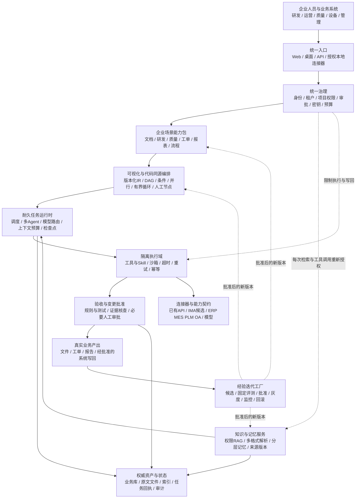
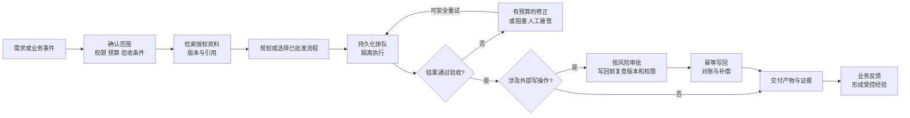
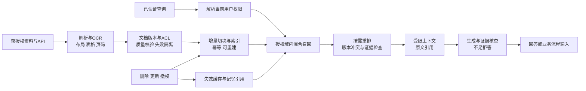
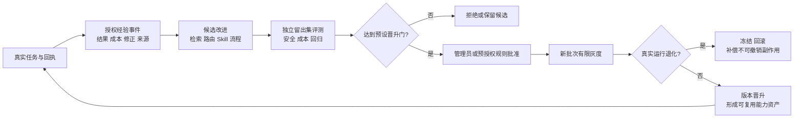

# FY-Orbit 企业生产愿景蓝图

版本0.1 · 2026-10-11 · 设计提案，待来源总账、代码审查与用户评审；不是现状图，不是已满足声明，也不是施工指令。

## 1. 定位与设计前提

目标：从AI工具集合发展为“企业智能体能力运行与演进平台”。统一执行与治理基座，组合行业场景能力包，按企业、项目、岗位适配，并用真实交付经验改进下一轮。通用性指可扩展契约与复用机制，不指任何任务都能处理；个性化不能越过安全、数据授权和费用边界。

需求来源是本Codex会话2026-10-11的用户消息，以及任务包00/03/06/07/08的整理记录。以下V编号是本蓝图的临时追踪ID，**不是全目录归一需求总账，也未替代外部Agent的历史版本对比**。已实现状态需以后续代码→API→持久化→集成→真实E2E证据补齐，当前一律不能由此图判定。

方案取舍：建议统一模块化基座，隔离执行worker与可替换数据/API适配器；相比立即搭全套微服务，短期维护和资源成本更低；相比完全依赖外部知识/Agent SaaS，更能保留业务权限、版本与迁移控制，但承担维护责任。纯外部API组合可作为首批适配方式，不能代替平台自己的业务状态和授权。大型企业部署是后续分级形态，不宣称当前2–3G云机可承载它。

## 2. 总体目标架构

可打开的简明总览见同目录HTML；本图为更细的Mermaid语义源。箭头是目标数据/控制流，不代表当前连通。每个“层”是逻辑责任，**不要求每个框成为一台服务器或微服务**。

贯穿约束：tenant/project/actor、task/run/trace、input/document版本、workflow/skill/model/policy版本、授权快照、费用来源和产物摘要。服务端验证身份，不相信请求方自报owner。每次工具调用、上下文检索、审批后写回均验证当前权限；授权撤回不因旧检查点而失效。

## 3. 一次真实生产任务如何闭环

“成功”必须是产物满足验收且必要业务状态可对账，不是Agent说已完成。外部API超时但可能已执行时先对账，不能直接重试造成重复工单/通知/写入。断点恢复不等于撤销已产生费用或副作用。审批绑定具体产物、动作、数据版本与权限，修改后重新审批。

生产任务的失败出口是正常能力：不支持、无权限、预算不足、缺少证据、依赖不可用必须明确停止并保留检查点，不能靠模型编造填补。

## 4. 企业资料与RAG链路

为什么这样设计：企业知识常含设备型号、规程编号、表格数值和修订版本，不能只靠“语义相似”。混合检索和重排是可评测选项，不是默认越多越好。权限必须先约束召回和模型上下文，不能回答后才隐藏引用。原文、索引、经验、缓存分别保存生命周期，文档撤权需同步传播。

首批格式范围建议按08任务书核验PDF/扫描PDF、DOCX、XLSX/CSV、PPTX、TXT/Markdown、HTML与图片；CAD/专有格式和工程公式单独标支持边界。用户自建IMA公共知识库为优先接入候选，API授权、检索粒度、引用、更新、费用及导出未验证前，不承诺已接通。知识检索失败不得暗换知识库。

先建立获授权样本与业务题库，再测Recall@k、引用正确、证据支持、无答案拒答、权限反例、p95和真实总成本；测试档位不冒充典型中小企业统计规模。把调优样本与独立验收样本分开。

## 5. 自迭代是受控改进，不是自己无限改自己

适配顺序：平台安全约束不可覆盖；其下由企业基线→项目/流程→角色/用户作允许范围内细化。不同企业可选择质量、费用、时效、数据驻留等不同目标，不能只用平均成功率覆盖某岗位退化。每个运行冻结已批准版本，新版本仅影响新批次；学习证据不足保持基线，允许关闭个性化和冻结版本。

记忆分为工作/事件/语义/程序资产，但类别名称不能替代ACL与持久化。经验来源事实与模型“教训总结”分开。禁止自动改权限策略、预算上限、评测答案、审查配置，禁止默认跨企业学习。代码/架构修改走软件发布流程；模型权重训练另走数据、训练与评测流程，不混称系统自迭代。

护城河假设是“合法可用的业务经验＋稳定连接器＋行业验收标准＋治理可信度＋持续实测”，不是Skill数量或反思长度。需用同任务、同预算的实际交付成功率、人工重做、成本和退化证明收益。

## 6. 本蓝图覆盖哪些用户需求，为什么

下表“覆盖”仅指设计响应，并不意味着当前实现满足。

| 临时ID / 用户目标 | 设计响应 | 设计理由与验收方向 |
|---|---|---|
| V01 真正端到端生产交付 | 执行→验收→产物→业务写回→对账 | 避免只展示聊天；真实业务题、产物与回执验收 |
| V02 面向大中小企业与工厂 | 同契约、分档部署、行业能力包 | 复用逻辑但按安全/负载/现场条件部署，不靠一台机器“通吃” |
| V03 平台型源头能力工厂 | 模型/工具/Skill/适配器/编排IR版本契约 | 能组合生成可复用能力资产；合法性、兼容性和真任务验收 |
| V04 通用兼容又独特适配 | 企业→项目→角色配置，安全边界不可覆盖 | 各对象目标不同；验收隔离、禁越权、禁负向迁移 |
| V05 多Agent与长上下文 | 调度、上下文预算、证据、检查点、状态权威源 | 不是Agent越多越好；测任务完成、重试、恢复与上下文丢失 |
| V06 多编排/拓扑与可视化 | 同一版本化IR，画布/代码为视图 | 防图代码各跑一套；先验证语义同一再扩拓扑 |
| V07 共同记忆与持续自迭代 | 分层记忆、权限经验、留出集、灰度和回滚 | 持续改进可观测，不把总结当真值；测成功与人工修正 |
| V08 企业大规模RAG | 多格式解析、版本/ACL、增量索引、检索与引用 | 正确且有权使用资料；数据规模/并发与恢复实测 |
| V09 Web与桌面同等核心能力 | 共用能力契约和服务；本地功能经授权连接器 | 核心流程一致；OS/本地文件等能力仍有环境差异 |
| V10 短期低成本在线体验 | 小规模单机基线、按需API、预算门、可迁移退出包 | 一个月服务也要真实；不将低资源演示等同大型生产 |
| V11 复用已有API与IMA | 适配器登记、认证、健康检查、费用与来源 | 减少重复建设；用户所有权不等于接口已经可用 |
| V12 企业愿意采用及竞品竞争力 | 业务成效、IT治理、交付可用性、运维与退出 | 让采购/业务/IT均有验收依据；竞品超越须另用官方版本与同题测量证明 |

## 7. 企业/工厂场景如何实际落地（候选，不是已验证客户案例）

- 工厂质量：读取有效规程和检验表→发现异常→生成含引用的整改建议→质量负责人批准→MES/QMS工单写回→追踪闭环。数据版本、规则与批准留存；不直接改变机台参数。
- 设备维护：依据设备型号、手册和维修记录生成故障排查/备件建议与维护工单，危险动作由合格人员执行；无依据不猜测安全操作。
- 工程研发：需求/设计资料→检索规范→任务分解与多Agent执行→代码/文档/测试产物→工程师审查→PLM/项目系统受控写回。不能把自动生成方案当作安全或合规认证。
- 中小企业办公：合同/订单/表格整理→规则核查与知识问答→报告/待办→人工批准发送或录入。财务记账、付款等高风险动作分开授权，先只读/建议。

这些流程是能力包候选，需要用户业务事实确认、API契约和真实题目验证。首批优先挑选资料易获取、收益可测、危险副作用可控的两三条，不同时造完整ERP、MES、PLM、财务与工控系统。

## 8. 分档部署：同能力契约，不同承载规模

| 档位 | 建议形态（非已选技术栈） | 升级依据 / 边界 |
|---|---|---|
| 一个月面试体验 | Ubuntu单实例、持久化状态、少量隔离worker、已有外部模型/知识API | 先确认2–3G含义；限制账户/并发/预算；不是高可用，也不承诺大规模承载 |
| 中小企业试点 | 企业身份与权限、独立执行域、可备份存储、任务队列 | 真实资料/岗位流程、恢复演练、管理员运维与数据导出通过后使用 |
| 中型企业部门/工厂 | 按负载扩worker与解析/索引能力，业务连接器，网络分区与监控 | 分档容量、隔离/授权、业务对账、可用性目标及维护责任冻结 |
| 大型集团/多工厂 | 企业身份联合、按需要租户/部署隔离、多站点数据策略、冗余与灾备 | 单独设计和测量SLO、RPO/RTO、驻留、容量、升级与应急接管；绝非临时云机放大宣传 |

不凭企业人数决定档位；输入资料、并发、任务成本、业务关键性和安全边界共同决定。不能在未演练情况下宣称高可用或灾备。云服务到期前迁移/恢复测试，不能将原文资料只放向量索引。

工控边界：FY-Orbit定位业务/知识协同和经批准的系统接口层，不默认直接控制PLC、DCS或安全仪表。设备控制和安全联锁仍由现场合格系统/人员承担；网络隔离、时延、失效安全和现场批准需单独工程审查。这是基于OT特殊安全/可靠性要求的保守设计判断，不是某个标准对本产品的认证。

## 9. 生产准入与实施顺序

P0：冻结代码/需求/宣传基线；修启动、隔离、执行安全与伪成功/伪费用；回归到实际可交付。公开main/Release独立复验。
P1：选两三条业务流程打通真实Web/桌面→API→持久化→产物；以低成本Ubuntu云端提供有限授权体验，备份与到期迁移先验收。
P2：企业资料/RAG、身份与审批、业务连接器、现场流程、运行支持；达到试点验收再扩大。
P3：受控经验迭代、能力包与适配层；同题同预算测收益，安全/成本退化阻断晋升。
P4：负载与组织需要证明后扩容、灾备及集团治理。最终顺序须结合外部总账缺口裁决，不由本草图替代。

上线必须有：完整失败出口、真实模型/API回执、权限负向测试、实际费用、产物验收、备份恢复、关键操作批准/幂等/补偿、容量与限流、升级回滚、责任人与支持流程。目标阈值在具体业务规格中先冻结，不能测试后包装。存在未解决的越权/危险执行缺口则不得公开。

## 10. 依据与当前限制

用户目标：当前会话role=user；整理出处：deliverables/agent-task-orders/2026-10-11/00、03、06、07、08。这是本轮归纳，不是全量原文档案；正式历史ID待外部来源总账回传。

设计参考（2026-10-11查阅；不构成FY已实现证据）：
- [LangGraph Persistence](https://docs.langchain.com/oss/python/langgraph/persistence)：区分线程检查点与跨线程存储，内存checkpoint不承受重启。本蓝图据此要求耐久状态与长期记忆分开治理。
- [Microsoft 多租户RAG安全设计](https://learn.microsoft.com/en-us/azure/architecture/ai-ml/guide/secure-multitenant-rag)：只允许把用户有权访问的内容作为模型依据；这里借鉴授权原则，不要求采购Azure。
- [NIST SP 800-82 Rev.3](https://csrc.nist.gov/pubs/sp/800/82/r3/final)：OT具有特殊性能、可靠性和安全要求；这里据此提出工控边界，不声称认证或完整符合标准。

现状限制：本蓝图未重新核验当前全部代码、全部公开发行或竞品，因此不标“当前满足”。任务包v1.3与公共池已有相关实施任务；未部署、未采购、未改变产品架构或官网宣传。此文件与图由用户评审后，仍需正式来源/缺口审查再进入逐文件实施计划。
